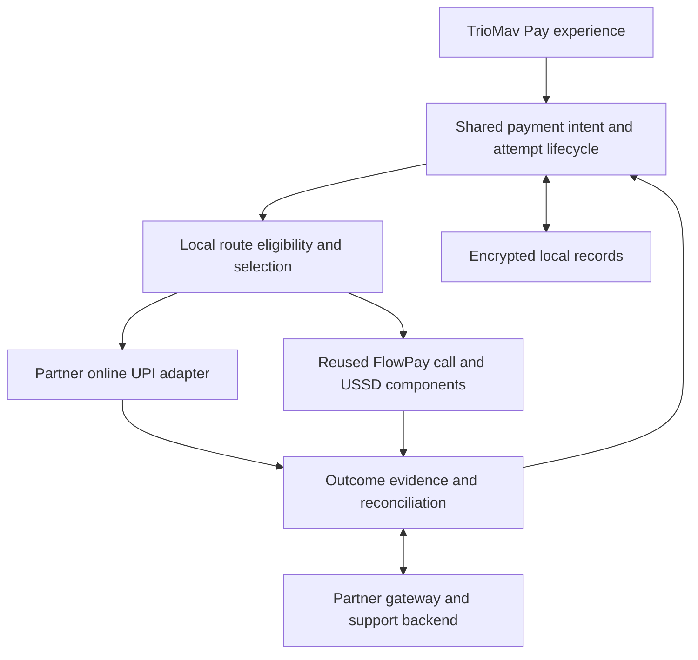

# TrioMav Pay: simple everyday payments, built with FlowPay

Working product blueprint · 26 September 2026

The user has named the product **TrioMav Pay**: a simple everyday payment app for India, shaped by users and merchants and built on existing payment networks. **FlowPay's architecture is a reusable part of the foundation** for its supported no-data payment flows, durable payment records and recovery behavior. TrioMav Pay adds the broader app experience, online payment integration, route coordination and support. This is a proposed design, not a claim that the integrations or launch prerequisites already exist.

The names have distinct roles: TrioMav Pay is the consumer product; FlowPay identifies the underlying architecture and components we reuse. Users navigate one TrioMav Pay experience. They do not need to choose between two app brands or install a separate FlowPay app to use the planned integrated experience.

## Product definition

Help a person pay a familiar merchant or another person, understand what happened to their money, and resolve problems when connectivity changes.

Simplicity is the primary product principle: one obvious next action, familiar payment language, and only the information needed to act confidently. Treat “one of the simplest payment apps” as the design ambition to validate with users, rather than an established market ranking.

The everyday experience stays familiar: scan or choose a recipient, check the recipient and amount, authorize, and see the outcome. The app assesses eligible payment routes before submission. It explains a meaningful change, such as needing to complete a phone call, instead of asking the user to understand USSD or IVR.

The central promise is **“Pay with confidence, even when connectivity changes.”** Marketing claims must name the supported conditions. No-data support does not establish no-signal support.

The ambition is national adoption. The initial product is Android-first, with one geographic pilot and its local language plus English. These are proposed starting choices, based on the existing Android implementation; they do not commit the eventual product to one platform or language.

## What the app should feel like

A customer scans a vegetable seller's QR to pay ₹80. When an eligible online route is reachable, the app takes them through its approved authentication flow. When mobile data is unavailable, it checks whether a supported call-based route is already available to that customer and recipient. If so, it explains “You can complete this payment by phone” and guides the handoff with the recipient and amount retained where the integration supports that.

If a payment may already have been submitted, the app preserves that attempt and shows “Checking your payment.” It does not initiate another transfer because internet returned. If no supported route is available, it states that payment cannot currently proceed and lets the user retain the details without scheduling an automatic debit.

The merchant confirms receipt through their own trusted payment channel. A customer's screenshot or locally generated receipt is not independent proof of receipt.

## First release: a simple home with clear supporting areas

The home screen emphasizes **Scan & Pay**, with **Pay someone** and **Receive** as secondary actions. Recent payments provide quick access to Activity; Profile lives behind the account control; Help is reachable from payment details and a persistent accessible entry point. These are information areas, not a requirement for four equal tabs. Surface an unresolved payment prominently when it needs attention. Do not add a network-mode selector to normal checkout.

| Place | User purpose | First-release contents |
| --- | --- | --- |
| Pay | Make or receive an everyday payment | Prominent scan action, pay by supported UPI ID/contact lookup, recent recipients, own receive QR, linked-account access |
| Activity | Know where the money went | Payments with plain-language status, reference and evidence provenance, unresolved attempts, payment-specific help |
| Help | Resolve a payment problem | Transaction-linked complaint, next action, case status and escalation through the agreed partner process |
| Profile | Control the account and app | Language, accessibility, linked accounts, permissions, privacy and account/device recovery |

Contact lookup, account linking and receive-QR provisioning depend on partner support. Do not imply that every phone number is a valid payment address. Keep manual UPI ID entry available where supported, so contact access is optional.

Onboarding chooses a language, follows approved device/account registration, and establishes which routes the customer can use. Show an unavailable route as unavailable. Ask for permissions at the action that needs them. Retain usable QR/manual entry and history paths when optional permissions are declined. Never ask for a PIN in app-owned forms or send one to support.

Use readable amounts, recipient details, text with status colours, screen-reader labels, and a low-data interface. Avoid a persistent network dashboard; show connectivity information when it helps the user decide what to do.

## Route selection contract

The engine is deterministic and testable. Inputs include local connectivity observations, recent service reachability, selected account and SIM, enrollment, supported recipient/payment type, amount limits, consent, and existing payment state. Signal bars alone cannot establish route availability. Cached capabilities need expiry and a safe unavailable state when required facts are stale.

The current implementation maps QR payments to USSD and phone-number payments to IVR. Its IVR builder accepts phone numbers and whole rupees. Automatic switching must not invent a phone number from a VPA, round away paise, or change the recipient to fit a route. Only offer a fallback that can represent the exact intended payment through a verified integration.

| Condition | Proposed decision | Boundary |
| --- | --- | --- |
| Eligible online route is reachable; no attempt is submitted | Offer normal UPI authentication | Native integration requires a PSP/bank relationship and applicable participation requirements |
| Data is unavailable; a supported call/signalling route is eligible | Offer the appropriate FlowPay-assisted route | Verify bank, SIM, operator, provider and recipient support; follow required enrollment and authentication |
| A shared bank/service dependency is unavailable | Explain the service problem and assess genuinely independent eligible options | A different transport does not fix the same unavailable bank |
| No internet or cellular service | Show unavailable in the initial release | A future approved offline facility is a separate partner, device, acceptance and funds-capability track |
| Any earlier attempt could have been submitted | Hold new automatic initiation and resolve the original attempt | Local identifiers do not provide cross-network exactly-once execution |

Select or change routes before submission. If the route changes the authorization flow, funding source, fees, timing or guarantees, explain those changes and obtain the necessary user authorization. Preserve recipient and amount as one immutable intent; any change creates an explicit new intent. Never replay authorization across routes.

Connectivity returning may trigger status retrieval and record synchronization. It must not trigger a new money movement for an old checkout.

## Payment outcomes and evidence

| User-facing state | Meaning | Next action |
| --- | --- | --- |
| Ready to pay | No payment instruction submitted | Review and authorize, or leave |
| Processing | An instruction has been submitted or may have been submitted | Stay with the same attempt |
| Checking payment | Outcome is uncertain, including after timeout or process restart | Query the authorized status source when available; otherwise guide review |
| Paid | The route's approved outcome evidence confirms the intended payment | Show reference and receipt details |
| Failed | Definitive outcome says the payment did not complete | Offer a fresh authorized attempt only when the route's retry rules permit |
| Reversal pending / Reversed | Money movement was reversed or reversal is being tracked | Show the distinct reversal state and available support |

Treat a bank debit, recipient credit, and reversal as distinct events where the partner exposes them. A debit alone must not be described as confirmed recipient receipt. Never infer financial success from elapsed time, call completion, an AI confidence score, or a same-amount SMS alone.

The current FlowPay SMS/call flow is an existing integration candidate, not authoritative verification for every transaction. Its uncertainty handling and lessons should survive; its evidence policy must be reviewed for the new product. Customer-supplied or merchant-reported evidence stays labelled by source.

## Technical shape

The local app retains the routing information and records needed for supported no-data flows. A backend is proposed for partner integration, authoritative status retrieval where available, reconciliation and support. It must not become a mandatory online dependency for a route designed to operate without mobile data.

The shared lifecycle builds on FlowPay's persistence and uncertainty-handling lessons. Online UPI integration and automatic cross-route coordination are additions in TrioMav Pay. This boundary preserves the existing foundation while making its current capability limits explicit.

Start with a modular Android app and one maintainable backend deployment with clear internal boundaries. Choose the backend stack after confirming partner SDKs, interfaces and team skills. Keep PIN handling within approved authentication components. Store the minimum payment/support data required under the applicable partner and regulatory obligations; restrict support access and exclude secrets and raw message bodies from general telemetry.

Core records: immutable payment intent, separately identified route attempts, partner references, timestamped evidence with provenance, derived status, and support case. Record attempts durably before side effects. Deduplicate callbacks and repeated events; tolerate out-of-order delivery. Where APIs expose idempotency, use it according to their contract. Unsupported status or idempotency capabilities must be explicit.

Suggested route interface responsibilities: eligibility, preparation, authorized initiation, supported status lookup, evidence interpretation, and dispute-reference retrieval. Cancellation must report whether submission is definitely prevented or the result is unknown. Do not expose a generic “cancel payment” action that promises to undo an already submitted transfer.

## Preserve the lessons; review the implementation

| Existing foundation | Rebuild decision |
| --- | --- |
| QR parsing, currency handling and Android payment UI experience | Reuse after input, recipient-confirmation and accessibility review |
| Durable payment attempts and explicit uncertainty | Preserve as product invariants across every route |
| Session management, stale-record recovery and duplicate message handling | Generalize to multiple adapters with independent attempt references |
| One active session and one SMS operation window | Replace superseding behavior with an explicit unresolved-attempt guard and stronger evidence correlation; this is new work, not existing protection |
| USSD/call initiation and lifecycle observations | Isolate behind provider-specific adapters; verify behavior on actual supported combinations |
| SMS parser and captured failure cases | Retain as secondary evidence and regression examples; do not elevate weak matches to authoritative proof |
| Local-only architecture | Add partner/backend boundaries while preserving useful offline behavior |
| Universal bank/SIM/network claims | Replace with a capability matrix supported by field and partner evidence |

Do not begin by deleting the working application. Maintain the current app as a reference while the new lifecycle and interfaces are exercised in a separate implementation boundary. Migrate reusable code only after its behavior is understood. Local history migration needs explicit handling when identifiers and statuses change.

## Release sequence and decision gates

| Stage | Concrete deliverable | Evidence needed to advance |
| --- | --- | --- |
| 1. Lock the product contract | Screen flows, route matrix, payment-state rules, partner questions, and a register of known failures | Every first-release scenario has an outcome, owner and support path; partner-dependent items are identified |
| 2. Demonstrate the experience | A clickable prototype with online, no-data, unavailable and uncertain-payment scenarios | Pilot users understand the next action, recipient and money status without coaching; simulated outcomes are clearly labelled |
| 3. Prove integrations | One online integration and the supported FlowPay route in the permitted test environment | Enrollment, authentication, status, failures and reconciliation are evidenced for each supported combination |
| 4. Run a controlled live pilot | Everyday checkout in one market cluster, proposed 20–30 merchants and 100–200 repeat customers | Required partner/distribution readiness; support staffing; no unresolved false-success or duplicate-debit defect; observed use and recovery performance |
| 5. Expand adjacent communities | More devices, language coverage and merchant clusters | Retention, payment outcomes and support capacity remain acceptable under the expanded mix |

The full product pilot depends on real integration access. A prototype or app-to-app handoff can demonstrate a journey while that work progresses, but does not establish native UPI capability or authoritative payment status.

Engineering can proceed in parallel on the lifecycle, interface contracts and simulated partner adapters. Do not commit to a nationwide launch date before partner access, team capacity and field results are known.

## Validation that protects the rebuild

Carry these scenarios into a shared scenario register with expected behavior, evidence and owner:

- Data is lost before initiation, during authentication, and after possible submission.
- The user exits or presses Cancel after entering a PIN.
- The app is killed and restarted while a payment is unresolved.
- The bank completes a transfer without an SMS, or messages arrive late, twice or out of order.
- Two unrelated transactions have the same amount.
- A partner callback is redelivered, contradicts weaker evidence, or reports a later reversal.
- The selected SIM, linked account or permission changes between setup and payment.
- The recipient lookup is unavailable or a QR does not provide a verifiable display name.
- Internet returns while an uncertain attempt is open.
- The merchant disputes receipt despite a customer-side debit or success indication.
- The phone is replaced or lost; the user needs account recovery and access to unresolved history.

Exercise supported bank/operator/device combinations, including low-end devices and accessibility paths. A passing unit test cannot validate a live carrier or bank flow. Live testing uses the agreed partner process, consenting participants and controlled amounts.

## Community, adoption and sustainability

Create a rotating group of pilot customers and merchants who help prioritize problems and review language and onboarding. Publish a short “You asked; we changed” record. Community votes inform priorities alongside payment safety, accessibility and observed friction. Authorized staff and partners handle payment investigations; community volunteers never need PINs, credentials or private transaction access.

Recruit merchants and repeat customers together through a trusted local association or organization. Use the app during ordinary good-connectivity days as well as difficult ones so it can earn a place in everyday checkout. Expand by adjacent clusters after support and retention are stable. Avoid making cashback the only reason to return.

The commercial starting hypothesis is free ordinary consumer payments, a funded pilot, and later optional merchant services if evidence supports willingness to pay. Test reconciliation/export or business-record needs before building them. Do not assume revenue from every UPI transfer. Budget explicitly for integration, infrastructure, telecom/provider charges where applicable, support, fraud/loss responsibility, and distribution.

Keep initial scope concentrated on payment, receipt, recovery and help. Lending, investments, social feeds, rewards games, community relay networks and a proprietary stored-value system are outside the initial scope.

## Measures for wider adoption

Define metrics before the pilot and segment by route, bank/operator/device combination and network condition:

- Confirmed completion as a share of user-authorized checkout attempts, including attempts that never reached the payment provider; keep unknowns in the denominator.
- False “Paid” displays and duplicate debits attributable to the app: zero tolerated; any incident triggers investigation and containment, not a statistical success claim.
- Time to a known outcome, unresolved-attempt backlog and time to resolve a support case.
- Repeat use without incentives and merchant retention.
- Permission/onboarding abandonment, checkout comprehension and accessibility failures.
- Cost to support an active user and an unresolved transaction.

Record both normal and poor-connectivity baselines; do not exclude difficult attempts to inflate reliability. Set numerical improvement and retention thresholds after observing the baseline and partner capabilities. Instrument only what is necessary, with the required disclosure and controls. Publish aggregate community results without exposing personal payment data.

## Decisions still needed

The product direction and name, TrioMav Pay, are settled. The next decisions are first pilot location/language, available team and budget, current partner contacts/access, supported first-release routes, and responsibility for operations/support. A later pass can define the visual identity and broader platform coverage. These do not block writing the product contract or building a clearly simulated prototype.

## Evidence and external dependencies

The current-state baseline comes from [the existing architecture](ARCHITECTURE.md) and [the offline roadmap](TRIOMAV_OFFLINE_ROADMAP.md). They describe an Android call/USSD front end with local records and no native online PSP integration. Documentation and source review are not a new live-payment verification.

- [UPI participant responsibilities, published by Axis Bank](https://www.axis.bank.in/docs/default-source/default-document-library/roles-and-responsibilities-of-npci-psp-and-tpaps-in-unified-payments-interface.pdf?sfvrsn=4cafa017_1): TPAP participation through a PSP bank, security, payment-data and grievance responsibilities. Obtain the current applicable requirements from the chosen partner.
- [NPCI UPI 123Pay product booklet](https://www.npci.org.in/PDF/npci/upi-123pay/Product-Booklet.pdf): no-internet channels and the role of bank onboarding. Availability must be established for the particular integration.
- [RBI offline-payment framework](https://www.rbi.org.in/scripts/RTGS_Notification.aspx?Id=12215): offline facilities have their own participant and operating requirements; no-signal support is a separate capability track.
- [Google Play SMS and Call Log permission policy](https://support.google.com/googleplay/android-developer/answer/10208820), checked 26 September 2026: SMS-based financial transactions are an eligible exception category subject to review and approval. A working APK does not establish distribution approval.

No partner agreement, regulatory participation, permission approval, live integration or national availability is implied by this proposal.
